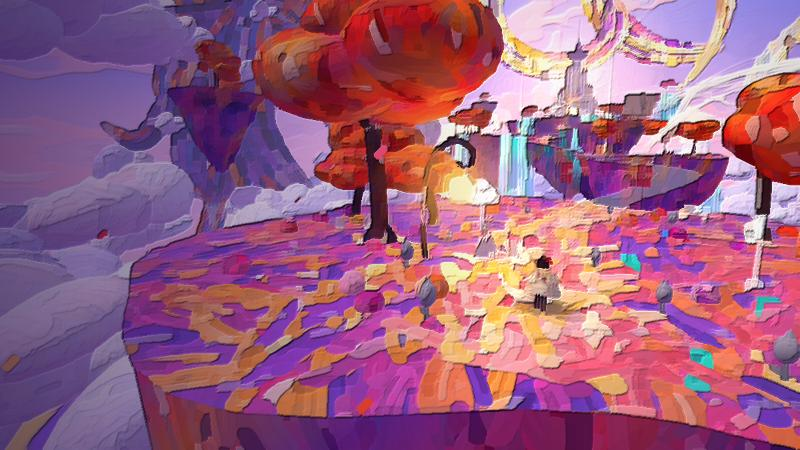

# The Everpainting Spire

A calm, painterly wander across five floating islands. Walk, skate and glide through a world that is still wet, paint it with your brush, wake what sleeps along the way, and lay the last stroke on the Spire yourself.

**[Play it in your browser](https://limittox.github.io/everpainting-spire/)**



There is no combat and nothing to fail. If you fall, the paint carries you back.

> **A note before you play:** this game changes as it goes. It begins gently, but its later parts are frightening, with blood and death, and are not for children.

## Controls

| Key | What it does |
|---|---|
| `W` `A` `S` `D` | Walk |
| Mouse | Look around (arrow keys also work) |
| `Shift` | Skate |
| `Space` | Jump; press again in the air to jump once more; hold in the air to glide |
| Click, or `J` / `F` | Swing the brush: it paints the ground and whatever stands nearby |
| `Q`, right-click, or `1`–`0` | Change paint |
| `E` | Hold to paint a sketched bridge; press to rest at an easel or step through a door |
| `G` | Sketchbook: your paintings and everything you have found |
| `C` | Photo mode |
| `H` | Map |
| `M` | Sound on or off |
| `P` | Cycle the brushwork filter |
| `Esc` | Settings |

On a phone or tablet: the left thumb walks (a stick appears wherever it comes down), the right thumb looks around, and on-screen buttons paint, jump and glide, skate, use (`E`), change paint (`Q`) and open the settings. The sketchbook, photo mode and the map are keyboard-only for now.

## What there is to do

- **Paint.** Every swing lays real strokes into the ground and soaks colour into trees, rocks and walls. Flowers come up where you walk.
- **Follow the route.** Paint the sketched bridges, gather three sparks of inspiration, and reach the Spire.
- **Rest.** Sit at an easel and the painter paints the view in front of it. Each finished picture is yours to save.
- **Look around.** There are sleeping companions to wake, sketches waiting to be painted into being, springs that colour their waterfalls, and a few places no path leads to.
- **Keep going.** The ending opens more of the world, and a second journey lets you start again with what you earned.

The journey is saved in your browser as you play.

### The Underpainting

The second level: a world still in pencil, where colour does things. It begins at night, and each thing you finish brings the morning closer.

- **Water** (Turquoise or Sky): paint a dry spring and water follows its channel, turns a wheel, and the wheel works a lift to the next terrace.
- **Growth** (Leaf): paint a sketched seed and a vine grows along the trellis drawn for it, into a bridge or a ramp.
- **Warmth** (Ember or Gold): painted ground gives off rising air. Jump in, hold Space, and it lifts you high enough to glide to places that were out of reach.
- **Blank** (Cream): takes paint back to paper. It wipes away old paint, and cools ground you warmed.

It ends on the Blank Page, where four wells each want one of the four, under the hand that drew it all.

You reach it by stepping into the unfinished canvas in the Spire's atelier, after the ending. To try it straight away, add `?underpainting` to the address.

### Varnishing Day

The third level: the gallery where the painting hangs, the day before the doors open. Two of the pictures on its walls can be stepped into.

**Three Tubes** was painted with three tubes of paint: red, yellow and blue. Inside it those are all your brush has, and anything else has to be mixed, by painting one colour over another. The place is a violet night with a great moon in it and a serpent of rock asleep round the moon: islands of dark crystal, trees that give off their own light, water going over every edge, arches and banners, and a road of every colour wound through it all. Three shoals of koi, one of each tube's colour, swim the air between the islands and keep whatever is painted over them. Paper moths hang over the flowers until they are given a colour, and then go to fly round the rings of the observatory. Fireworks go up over the far end of the picture from the moment you arrive. There is a telescope on the observatory's roof, trained on the serpent, which can be turned to look at anything else.

- **Blue and yellow make green**, and green grows: a sketched seed sends a vine across a gap.
- **Red and yellow make orange**, and orange warms: a sketched lamp lights, and its warm air lifts you.
- **Red and blue make violet**, and violet brings the evening, and paths of light that are only there at night.

Each sketch glows faintly in the colour it wants. A wrong mixture stays until Cream wipes it clean.

The way through it is a climb. A vine leads from the first island up to a gate; from the gate the road of every colour runs down and round, to be skated; at its foot stands an observatory, rings turning about its head, and stones hang round it in a rising spiral, to be climbed by jumping (the beads of light on two of them throw you up). From its roof, warm air carries you on.

There the picture stops explaining itself: the hour is yours to set, some things only stand by day and others only in the evening, and the way on needs both. At the far end is a village with its lights strung up, a piper, and everybody out dancing.

**The Sunken Tower** is a desert, and a whole day. It begins under a high white sun; the hour goes with you, so that it is gold by the time the tower is reached, the sun is going down as you climb it, and at the top it is night, with every star out.

- **The sand keeps the mark of whatever crosses it**: a furrow behind you, a wider one when you skate, a hollow where you land, a scoop where the brush strikes. The wind fills them in again, slowly.
- **Statues are sunk in it**: an avenue of seated figures, each pair deeper than the last, a great head thrown back, an open hand big enough to stand in.
- **The tower** leans, and is buried to half its height. The way up is round the outside: a stair with a gap in it, beams, platforms hung on ropes, a drum that throws you up, and at the last the evening wind, which lifts a gliding painter to the roof. If you fall from above one of its three galleries, the paint carries you back to that gallery; gliding down is left alone.
- **The beam** at the very top looks out over everything. Walk to the end of it and the view goes once round you, and the picture is finished.

You reach the gallery through a frame that stands on the Blank Page once the Underpainting is finished; after that a frame in the atelier leads straight there. To try it straight away, add `?gallery` to the address. What happens once the picture is finished is best found out by playing.

## Running it yourself

You need [Node.js](https://nodejs.org/) 18 or newer.

```bash
npm install
```

```bash
npm run dev
```

Then open http://localhost:5183.

To make a production build in `dist/`:

```bash
npm run build
```

Pushing to `main` builds and publishes the game to GitHub Pages (see `.github/workflows/pages.yml`).

## How it is made

The game is written in plain JavaScript with [three.js](https://threejs.org/) and built with [Vite](https://vitejs.dev/). It has no art or sound files:

- **The world** is generated in code: geometry coloured stroke by stroke, and island ground painted onto canvases with thousands of brush strokes.
- **The painterly look** is a post-process: a Kuwahara filter smears each frame like a palette knife, then a relief pass lights the paint as if it were thick.
- **The music and sounds** are synthesised with the Web Audio API. The music gains layers as you progress.

### Source layout

| File | What is in it |
|---|---|
| `src/main.js` | The game loop, rules, camera, menus, saving and restoring |
| `src/world.js` | Islands, bridges, the Spire, sky, sea, clouds and winds |
| `src/player.js`, `src/painter.js` | The painter: movement, animation, and the model with its cloth cape |
| `src/post.js` | The painterly post-process |
| `src/paint.js` | Brush strokes on the ground and colour soaked into objects |
| `src/bloom.js` | Flowers, buds and blossom that follow the painter |
| `src/vista.js` | Easels and the pictures painted at them |
| `src/entities.js` | Particles, sparks and companions |
| `src/sketches.js`, `src/setpieces.js`, `src/secrets.js` | Sketches, the island set-pieces and the hidden places |
| `src/interior.js`, `src/sights.js` | Inside the Spire, and the far-off sights |
| `src/underpainting.js`, `src/seedbed.js`, `src/lastpage.js` | The second level: running water, growing vines, warm air, and its ending |
| `src/gallery.js`, `src/tubes.js`, `src/dunes.js` | The third level: the gallery, the picture in it where colours are mixed, and the desert with its tower |
| `src/day.js`, `src/audio.js` | Time of day; music and sound |
| `src/hud.js`, `src/settings.js`, `src/save.js` | On-screen prompts and map, the settings panel, and storage |
| `src/util.js` | Shared helpers: palettes, noise, stroke geometry |

## Licence

[MIT](LICENSE)
