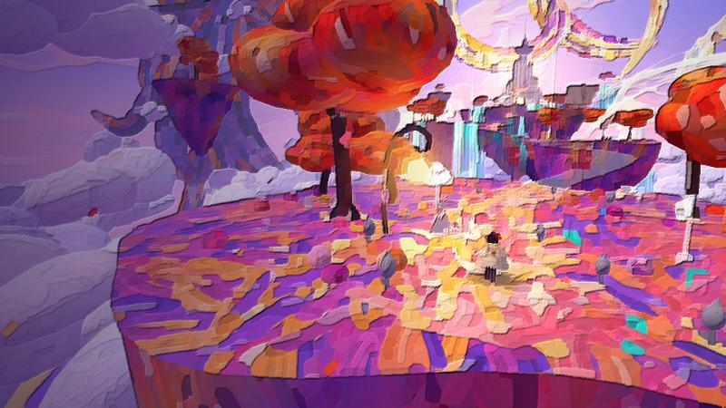

# The Everpainting Spire

A calm, painterly wander across five floating islands. Walk, skate and glide through a world that is still wet, paint it with your brush, wake what sleeps along the way, and lay the last stroke on the Spire yourself.

**[Play it in your browser](https://limittox.github.io/everpainting-spire/)**



There is no combat and nothing to fail. If you fall, the paint carries you back.

> **A note before you play:** this game changes as it goes. It begins gently, but its later parts are frightening, with blood and death, and are not for children.

## Controls

| Key | What it does |
|---|---|
| `W` `A` `S` `D` | Walk |
| Mouse | Look around (arrow keys also work) |
| `Shift` | Skate |
| `Space` | Jump; press again in the air to jump once more; hold in the air to glide |
| Click, or `J` / `F` | Swing the brush: it paints the ground and whatever stands nearby |
| `Q`, right-click, or `1`–`0` | Change paint |
| `E` | Hold to paint a sketched bridge; press to rest at an easel or step through a door |
| `G` | Sketchbook: your paintings and everything you have found |
| `C` | Photo mode |
| `H` | Map |
| `M` | Sound on or off |
| `P` | Cycle the brushwork filter |
| `Esc` | Settings |

## What there is to do

- **Paint.** Every swing lays real strokes into the ground and soaks colour into trees, rocks and walls. Flowers come up where you walk.
- **Follow the route.** Paint the sketched bridges, gather three sparks of inspiration, and reach the Spire.
- **Rest.** Sit at an easel and the painter paints the view in front of it. Each finished picture is yours to save.
- **Look around.** There are sleeping companions to wake, sketches waiting to be painted into being, springs that colour their waterfalls, and a few places no path leads to.
- **Keep going.** The ending opens more of the world, and a second journey lets you start again with what you earned.

The journey is saved in your browser as you play.

### The Underpainting

The second level: a world still in pencil, where colour does things. It begins at night, and each thing you finish brings the morning closer.

- **Water** (Turquoise or Sky): paint a dry spring and water follows its channel, turns a wheel, and the wheel works a lift to the next terrace.
- **Growth** (Leaf): paint a sketched seed and a vine grows along the trellis drawn for it, into a bridge or a ramp.
- **Warmth** (Ember or Gold): painted ground gives off rising air. Jump in, hold Space, and it lifts you high enough to glide to places that were out of reach.
- **Blank** (Cream): takes paint back to paper. It wipes away old paint, and cools ground you warmed.

It ends on the Blank Page, where four wells each want one of the four, under the hand that drew it all.

You reach it by stepping into the unfinished canvas in the Spire's atelier, after the ending. To try it straight away, add `?underpainting` to the address.

### Varnishing Day (in progress)

A third level is being built: the gallery where the painting hangs, the day before the doors open. The pictures on its walls are nearly finished. Each has too much of one thing and not enough of another, and here the brush learns to carry: stand by something, press E to lift it, and lay it down in another picture.

- **The Flood**: a drowned orchard. Lift the water and the ground comes back, ring by ring.
- **High Summer**: a parched field with a dry spring and a dry mill pond, each waiting for a brushful.

The brush holds one thing at a time, and anything laid down can be lifted again. You reach the gallery through a frame that stands on the Blank Page once the Underpainting is finished; after that a frame in the atelier leads straight there. To try it straight away, add `?gallery` to the address.

## Running it yourself

You need [Node.js](https://nodejs.org/) 18 or newer.

```bash
npm install
```

```bash
npm run dev
```

Then open http://localhost:5183.

To make a production build in `dist/`:

```bash
npm run build
```

Pushing to `main` builds and publishes the game to GitHub Pages (see `.github/workflows/pages.yml`).

## How it is made

The game is written in plain JavaScript with [three.js](https://threejs.org/) and built with [Vite](https://vitejs.dev/). It has no art or sound files:

- **The world** is generated in code: geometry coloured stroke by stroke, and island ground painted onto canvases with thousands of brush strokes.
- **The painterly look** is a post-process: a Kuwahara filter smears each frame like a palette knife, then a relief pass lights the paint as if it were thick.
- **The music and sounds** are synthesised with the Web Audio API. The music gains layers as you progress.

### Source layout

| File | What is in it |
|---|---|
| `src/main.js` | The game loop, rules, camera, menus, saving and restoring |
| `src/world.js` | Islands, bridges, the Spire, sky, sea, clouds and winds |
| `src/player.js`, `src/painter.js` | The painter: movement, animation, and the model with its cloth cape |
| `src/post.js` | The painterly post-process |
| `src/paint.js` | Brush strokes on the ground and colour soaked into objects |
| `src/bloom.js` | Flowers, buds and blossom that follow the painter |
| `src/vista.js` | Easels and the pictures painted at them |
| `src/entities.js` | Particles, sparks and companions |
| `src/sketches.js`, `src/setpieces.js`, `src/secrets.js` | Sketches, the island set-pieces and the hidden places |
| `src/interior.js`, `src/sights.js` | Inside the Spire, and the far-off sights |
| `src/underpainting.js`, `src/seedbed.js`, `src/lastpage.js` | The second level: running water, growing vines, warm air, and its ending |
| `src/gallery.js` | The third level: the gallery, its pictures, and lifting and carrying |
| `src/day.js`, `src/audio.js` | Time of day; music and sound |
| `src/hud.js`, `src/settings.js`, `src/save.js` | On-screen prompts and map, the settings panel, and storage |
| `src/util.js` | Shared helpers: palettes, noise, stroke geometry |

## Licence

[MIT](LICENSE)
